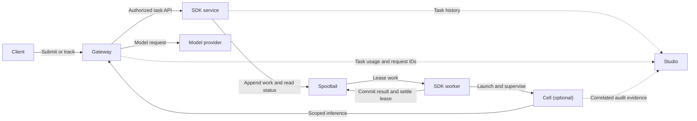

# Ecosystem architecture

Relayna lets an application submit a durable task through Gateway and lets an SDK worker execute it through Spooltail. Cell can isolate the execution. Studio assembles the evidence operators need to investigate it.

## Walk a task through the stack

1. **Authorize and accept.** A client submits to Gateway with a key scoped to a registered service. Gateway applies access policy and routes the request to that service's SDK endpoint. The SDK acknowledges acceptance after Spooltail durably appends the work.
2. **Claim and run.** An SDK worker claims a timed lease, renews it while working, and reports progress. With Cell, the broker-connected supervisor stays outside the sandbox and launches an isolated workload under the configured execution and network policy.
3. **Settle and replay.** On terminal completion, Spooltail records the status and settles the work lease atomically. Clients can request the latest status, page through history, or resume an event stream using its cursor. A retention gap tells the client where the retained history starts.
4. **Investigate and recover.** Studio reads task status and history through the registered SDK service. It correlates Gateway usage and Cell evidence when configured. Operator retry and dead-letter recovery are available when the service advertises the required capabilities.

A supported cancellation request records intent. The worker reports the terminal outcome, so clients should follow status or events to confirm cancellation.

## Sources of truth

| Information | Owner |
| --- | --- |
| Work delivery, lease fencing, committed status, and task history | Spooltail in the native profile |
| Handler behavior and application side effects | Agent application and its SDK worker |
| Caller identity, service grants, model policy, and request usage | Gateway |
| Sandbox lifecycle, isolation policy, and primary audit evidence | Cell |
| Service registry, investigation views, and operational projections | Studio |
| Versioned HTTP, event, and identity contracts | Relayna Protocol |

A lease can expire and another worker can run the task again. Use a stable application idempotency key for external side effects. Atomic broker completion fences stale lease holders and gives clients a durable terminal result.

Studio runs off the execution path. An operator can recover task evidence when Studio returns and the underlying sources still retain it. Previously accepted work can continue through a Gateway outage if the handler's dependencies are available. When Spooltail is unavailable, durable claims and settlements pause until it recovers.

## Observability and usage

Use the task ID and attempt ID to associate broker events with execution evidence. A trace ID connects request spans and logs where telemetry is configured. Store durable lifecycle events in Spooltail and retain detailed metrics, logs, and traces in their observability backends. Keep sandbox audit evidence in the Cell audit journal and large results in application-managed artifact storage.

Gateway meters task and inference requests according to the configured policy. Studio can display correlated request usage alongside execution evidence. Broader per-task accounting for tools, compute, and storage is described in the [roadmap](roadmap.md).

See the [v1.0 task and event contracts](https://github.com/Relayna/relayna-protocol/tree/main/contracts/v1.0) for endpoint, payload, and cursor details.
